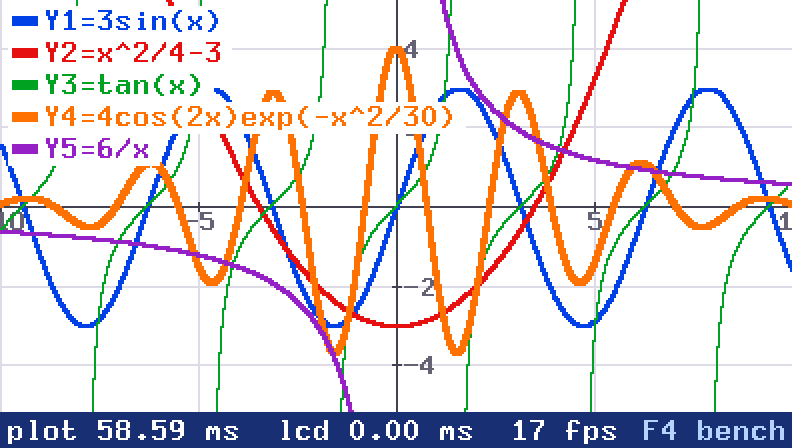
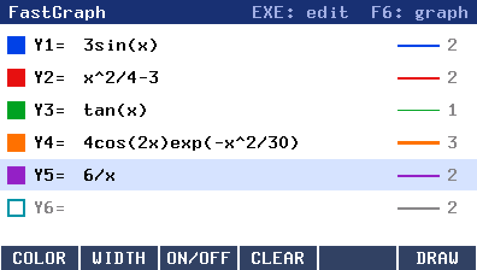

# FastGraph

FastGraph is a function grapher add-in for the Casio fx-CG50, written with
[gint](https://git.planet-casio.com/Lephenixnoir/gint). It graphs up to six
functions of x, each in its own colour and line width, and shows how long every
redraw takes. The calculator's CPU has no floating-point unit, so FastGraph
compiles each expression to a small bytecode and evaluates it with its own
single-precision float arithmetic written in integer code, which is much faster
than the compiler's generic soft-float routines.



*Five functions with the legend on. The bar at the bottom shows the time of the
last redraw; the numbers in this screenshot come from an emulator and do not
match a real calculator (see [Speed](#speed)).*



*The equation list: each row has a colour, a line width (1 to 6 pixels) and an
on/off switch.*

## Features

- Six equations, Y1 to Y6, each with one of 8 colours, a line width from 1 to 6
  pixels and an on/off switch.
- An editor with calculator keys for functions and constants; errors are shown
  with their position.
- Pan and zoom, with a 1/2/5 grid, labelled axes and a legend that can be turned
  off.
- Vertical asymptotes (`tan(x)`, `1/x`) are detected and not joined across.
- Every redraw shows its time in milliseconds and the frame rate.
- A benchmark (F4 on the graph) redraws the graph many times and reports the
  average and best time, the frame time including the screen transfer,
  evaluations per second, and the time of the grid and of each curve.
- The equations are saved in `FastGraph.txt` in the storage memory and loaded at
  start.

## Install

1. Download `FastGraph.g3a` from the [Releases](../../releases) page.
2. Connect the calculator by USB and choose USB Flash on the calculator.
3. Copy `FastGraph.g3a` to the root of the calculator's storage memory, then
   eject the drive.
4. Open FastGraph from the main menu.

FastGraph was written for and tested on the fx-CG50.

## Use

FastGraph starts on the equation list. F6 draws the graph; EXIT or F6 on the
graph goes back to the list. MENU returns to the calculator's main menu.

### Equation list

| Key | Action |
|---|---|
| UP, DOWN | Select a row |
| EXE | Edit the selected row |
| Any digit, operator or function key | Start a new expression on the selected row |
| F1 (SHIFT F1) | Next (previous) colour |
| F2 or RIGHT, LEFT | Thicker, thinner line |
| F3 | Turn the row on or off |
| F4 or DEL | Clear the row |
| F6 | Draw the graph (this also saves the equations) |

### Editor

| Key | Types |
|---|---|
| 0-9, `.`, `+`, `-`, `(-)`, `×`, `÷`, `(`, `)` | The character (`×` is `*`, `÷` is `/`) |
| X,θ,T | `x` |
| `^`, `x²` | `^`, `^2` |
| ×10^x | `*10^` |
| sin, cos, tan, ln, log | `sin(` `cos(` `tan(` `ln(` `log(` |
| SHIFT sin, cos, tan | `asin(` `acos(` `atan(` |
| SHIFT x² | `sqrt(` |
| SHIFT ln, SHIFT log | `e^(`, `10^(` |
| SHIFT ×10^x | `pi` |
| F1 to F6 | `abs(` `sqrt(` `pi` `e` `exp(` `floor(` |

LEFT and RIGHT move the cursor, UP and DOWN jump to the start and the end. DEL
deletes the character before the cursor, AC/ON clears the line. EXE accepts the
expression; if it has an error, the message is shown and the cursor moves to it.
EXIT cancels the edit.

### Graph

| Key | Action |
|---|---|
| Arrows | Pan by a tenth of the view |
| `+`, `-` | Zoom in, zoom out (by 1.5) |
| F1 | Reset the view (x from -10 to 10, square pixels) |
| F2 | Grid on/off |
| F3 | Legend on/off |
| F4 | Benchmark (any key returns) |
| EXIT or F6 | Back to the list |

### Expressions

- The variable is `x`. Numbers are written in decimal (`2`, `0.5`, `.5`).
- Operators: `+ - * / ^`. `^` is right-associative and its exponent may be
  negative (`2^-x`). `-x^2` means `-(x^2)`.
- Multiplication can be implicit: `2x`, `3sin(x)`, `(x+1)(x-1)`, `2pi`.
- Functions (the argument goes in parentheses): `sin cos tan asin acos atan
  sinh cosh tanh sqrt abs ln log exp floor ceil`. Angles are in radians, `log`
  is base 10 and `ln` is the natural logarithm.
- Constants: `pi` and `e`.
- A leading `y=` is accepted and ignored. Spaces are ignored. An expression can
  be up to 60 characters long.

Arithmetic is single precision. Functions are accurate to a relative error of
about 1e-6.

## Speed

Measured on a real fx-CG50 with the benchmark (F4), with two curves at the
default view (396 points per curve, 792 per frame):

| | Time |
|---|---|
| Plot (grid and curves), average | 28.16 ms (best 28.12 ms) |
| Frame including the screen transfer | 39.20 ms, 25 frames per second |
| Grid, axes and labels | 6.2 ms |
| `3sin(x)^2` | 7.27 ms |
| `4cos(2x)exp(-x^2/30)` | 13.51 ms |
| Evaluations per second | 28118 |

The screen transfer takes about 11 ms per frame.

## Building from source

FastGraph is built with the [fxSDK](https://git.planet-casio.com/Lephenixnoir/fxsdk)
and gint (2.9 or later), with OpenLibm. With the SDK installed:

```
fxsdk build-cg
```

This produces `FastGraph.g3a`. fxconv needs Python with Pillow to convert the font.

The float arithmetic and the expression compiler can be tested on a computer:

```
cc -O1 -o test_ff tools/test_ff.c -lm && ./test_ff
cc -O1 -o test_expr tools/test_expr.c -lm && ./test_expr
```

The font is X.org's misc-fixed 8x13B (public domain, in `tools/fonts/`);
`tools/bdf2png.py` converts it to `assets-cg/font8x13b.png`. The menu icons are
drawn by `tools/mkicon.py`.

## Licence

GPL-3.0-or-later (see `LICENSE`). The font is X.org's misc-fixed 8x13B (public domain, see
`tools/fonts/COPYING-misc-misc`). The released `FastGraph.g3a` also contains gint, fxlibc
(CC0) and parts of OpenLibm (MIT/BSD-style licences); their notices are in those projects.
